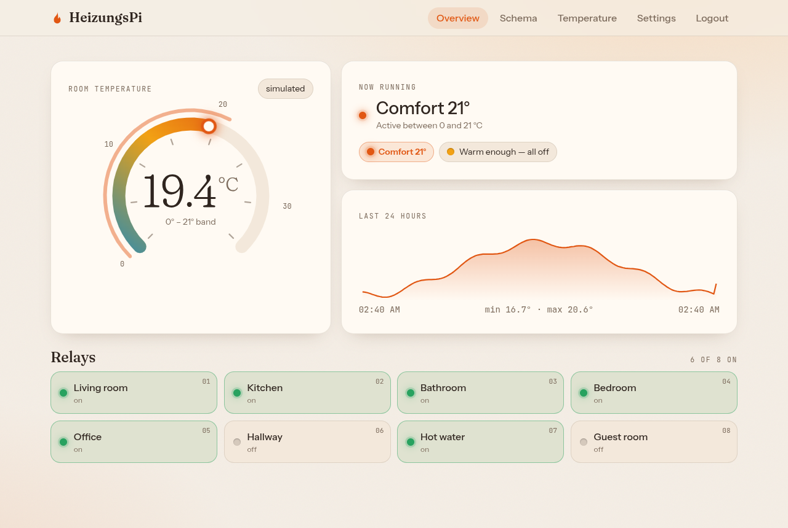
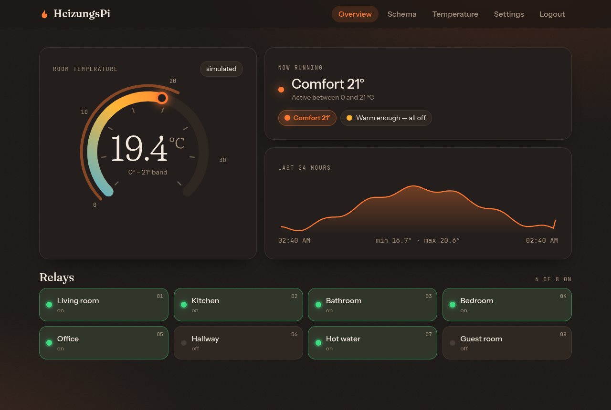
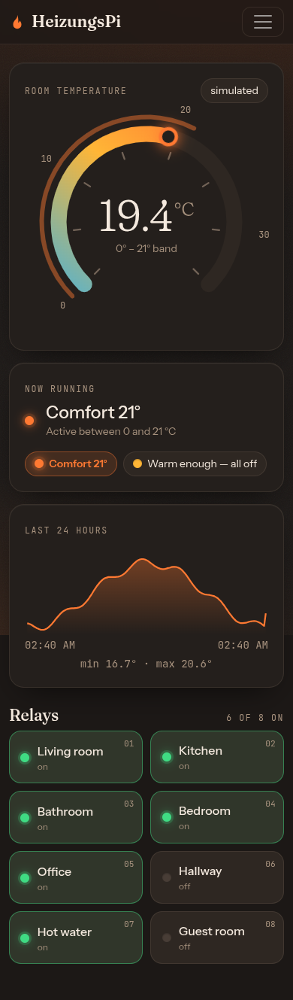
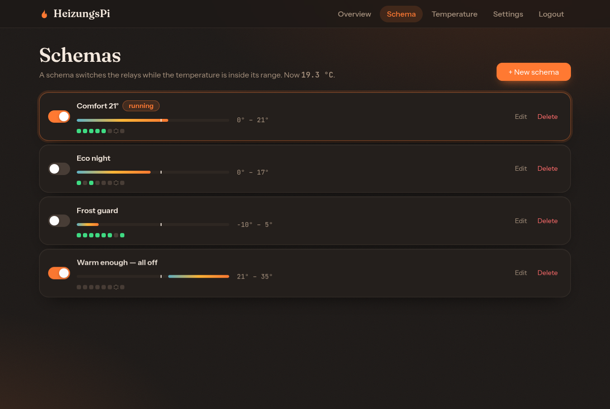
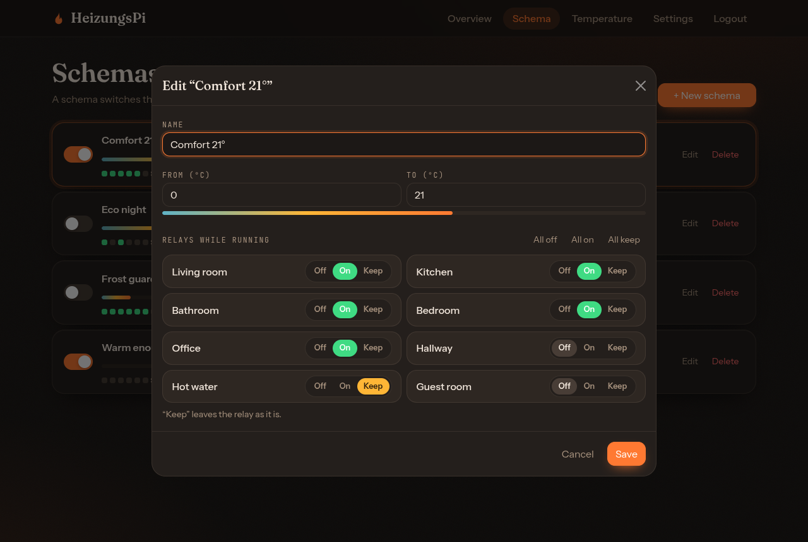
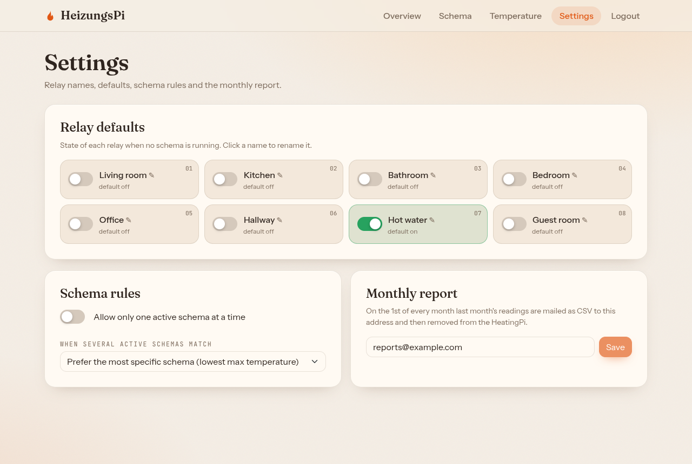
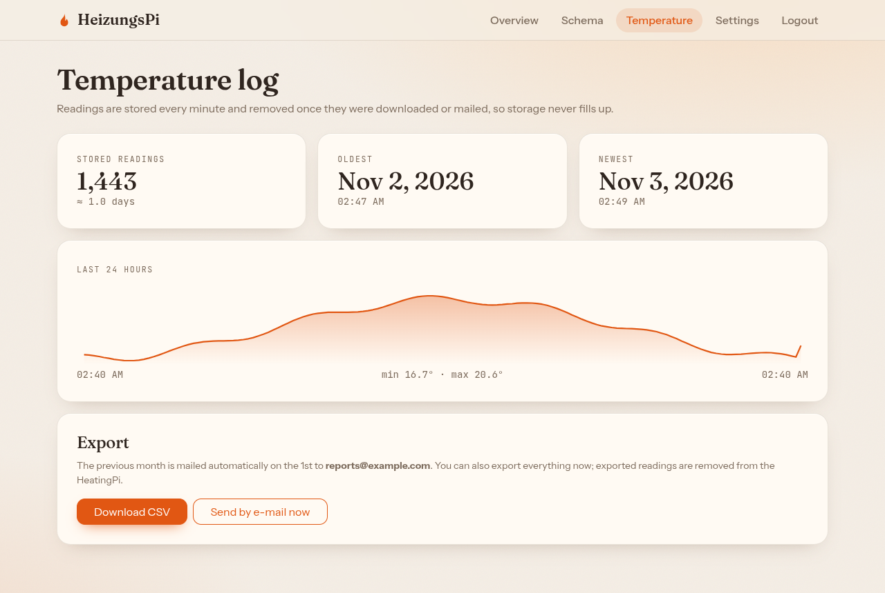

# HeatingPi v3
Controls a heating via Raspberry Pi (8 relays + DS18B20 temperature sensor) over a website.
Built to run on a Raspberry Pi 1 B: ~45 MB RAM, one native dependency, no build step on the Pi.



| Dark mode | Phone |
|---|---|
|  |  |

| Schemas | Edit a schema |
|---|---|
|  |  |

| Settings | Temperature log |
|---|---|
|  |  |

*(Screenshots use demo data and simulated hardware.)*

## Features
* **Schemas:** a temperature range plus, per relay, on / off / keep. Active schemas whose range
  contains the current temperature are applied every minute; otherwise relays use their default state.
* One-schema mode, or a priority rule when several schemas match.
* Live dashboard: dial with the current temperature and the running schema's band, 24 h chart, relay status.
* Monthly e-mail of the previous month's readings as CSV; readings are deleted after mail or download,
  so the SD card never fills up.
* Light and dark mode, works on phones.
* Public HTTPS via Tailscale Funnel; every change requires a login.

## Repository
- `server/` — Node 18 backend (REST API, relay control, temperature log, monthly mail)
- `web/` — React frontend (Vite)
- `deploy/` — install / update / rollback scripts for the Pi
- [docs/DEPLOY.md](docs/DEPLOY.md) — setup, deployment, HTTPS, operations, users

## Pins (Raspberry Pi 1 B, physical numbering, active-low relays)
Relay 1..8 = physical pins 3, 5, 11, 13, 15, 19, 21, 23 (BCM 2, 3, 17, 27, 22, 10, 9, 11 on rev 2 boards).
Sensor on physical pin 7 (GPIO4, `dtoverlay=w1-gpio`).

## Access
* LAN / Tailscale: `http://heatingpi:9000`
* Internet: `https://heatingpi.<tailnet>.ts.net` (Tailscale Funnel)

## Quick start (development)
```bash
cd server && npm install && npm test
DB_PATH=/tmp/dev.sqlite3 JWT_SECRET=$(head -c 40 /dev/urandom | base64) \
  DB_ENCRYPTION_SALT=dev DB_ENCRYPTION_PASSWORD=dev SIMULATE=true npm start
node src/cli.js add-user you@example.com 'some-password'   # same env vars as above
cd ../web && npm install && npm run dev                      # http://localhost:5173
```
